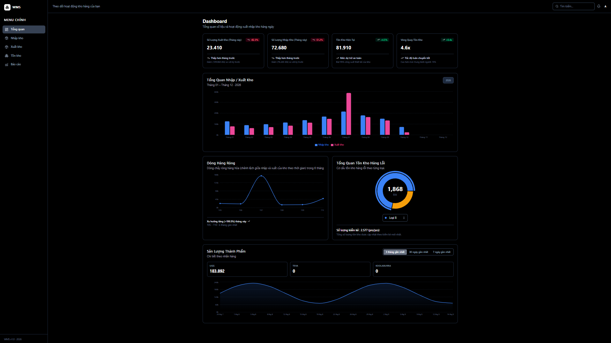

#  WMS Dashboard — Hệ Thống Quản Lý Kho Thông Minh

Giao diện Dashboard phân tích và giám sát hoạt động kho hàng thời gian thực, thiết kế theo phong cách tối hiện đại (Dark Theme), tối ưu hóa trải nghiệm người dùng và đảm bảo tính nhất quán dữ liệu giữa các chỉ số KPI và biểu đồ trực quan.

---

## Mục Tiêu Dự Án (Project Objectives)

- **Trực quan hóa hoạt động kho hàng**: Cung cấp bức tranh toàn diện về lưu lượng nhập - xuất, mức tồn kho thực tế, vòng quay kho và cơ cấu hàng hóa.
- **Tính toàn vẹn & nhất quán dữ liệu**: Toàn bộ số liệu trên thẻ KPI, biểu đồ cột Nhập/Xuất, đường xu hướng Dòng Hàng Ròng, tỷ trọng Hàng Lỗi và sản lượng Thương Hiệu đều được tính toán và dẫn xuất từ nguồn dữ liệu cốt lõi duy nhất.
- **Giao diện Dashboard**: Giao diện dark mode hiện đại, bố cục dạng lưới responsive, thanh bên (Sidebar) cố định tinh gọn, tương tác mượt mà trên mọi thiết bị.

---

## Mô Hình Dữ Liệu & Đồng Bộ (Data Synchronization)

| Thành phần | Nguồn dữ liệu & Cơ chế tính | Ý nghĩa số liệu |
| :--- | :--- | :--- |
| **KPI Xuất Kho (Tháng này)** | `monthlyData[current].outbound` | So sánh tự động với tháng liền trước tính % tăng/giảm và số lượng chênh lệch |
| **KPI Nhập Kho (Tháng này)** | `monthlyData[current].inbound` | So sánh tự động với tháng trước, đ|
| **KPI Tồn Kho Hiện Tại** | `Nhập Kho − Xuất Kho` | Phản ánh chính xác tổng lượng hàng đang lưu kho thực tế |
| **Biểu Đồ Cột (Bar Chart)** |  `monthlyData` | Tương quan dòng nhập và xuất kho theo từng chu kỳ |
| **Dòng Hàng Ròng (Line Chart)** | `\|inbound − outbound\|` | Thể hiện 6 tháng gần nhất, tự động tính xu hướng tăng/giảm tháng mới nhất |
| **Cơ Cấu Hàng Lỗi (Pie Chart)** | `stockConditionData` | Donut Chart với vòng active viền nổi, dropdown chọn loại xem chi tiết số lượng tâm và kiểm kê tổng |
| **Sản Lượng Thành Phẩm (Area Chart)**| Nhãn hàng (`UGG`, `TEVA`, `KOOLABURRA`) & Area theo mốc 7D / 30D / 3M | Phân tích xu hướng sản lượng theo thời gian và từng nhãn hiệu |

---

## Công Nghệ Sử Dụng (Tech Stack)

- **Ngôn ngữ & Nền tảng**: [React 19](https://react.dev/), [TypeScript](https://www.typescriptlang.org/)
- **Bundler**: [Vite](https://vitejs.dev/)
- **Giao diện & Styling**: [Tailwind CSS v4](https://tailwindcss.com/)
- **Biểu đồ trực quan (Data Viz)**: [Recharts v3](https://recharts.org/)
- **Hệ thống Icon**: [Lucide React](https://lucide.dev/)

---

## Ảnh Chụp Giao Diện Dashboard (Dashboard Preview)


> 

---
## Hướng Dẫn Cài Đặt & Chạy Ứng Dụng (Getting Started)

### 1. Cài đặt dependencies
```bash
npm install
```

### 2. Khởi chạy môi trường Dev
```bash
npm run dev
```
Truy cập dashboard tại: `http://localhost:5173`

### 3. Đóng gói kiểm tra Production
```bash
npm run build
npm run preview
```

